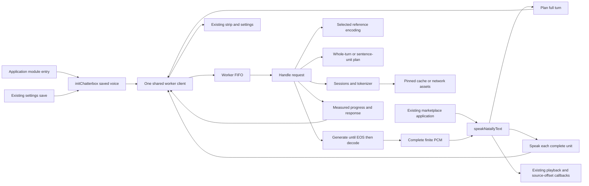
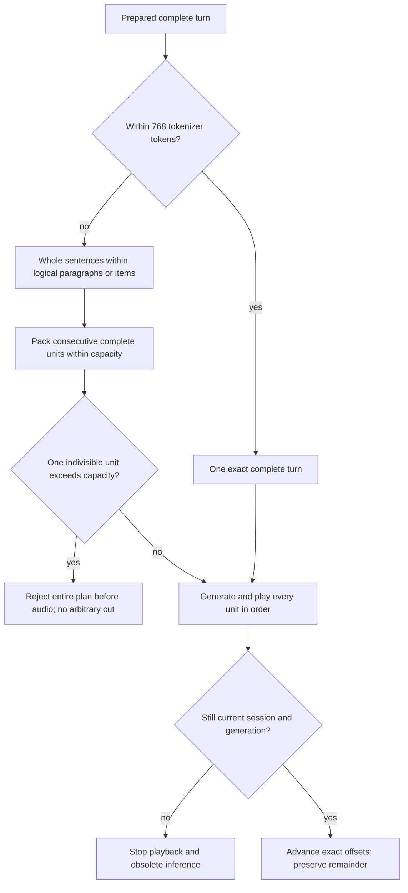

# Natally Chatterbox — closed architecture blueprint

| Contract | Fixed value |
|---|---|
| Revision / date | CB-ARCH-1 / 2026-10-15 |
| Design state | CB-ARCH-1 released for completion by Robin's subsequent instruction, "you should just complete it"; execute through the derived CHECKLIST |
| Repository / baseline | rebots-online/natally-chatterbox / f190a5ff64f2aa6b5ab3423022045343c4e22077 |
| Checkout / deployment target | E:/devProjects/natally-chatterbox / https://natally-chatterbox.surge.sh |
| Permitted product delta | Browser-local Chatterbox Nano ONNX replaces Supertonic; immediate background readiness; whole-turn/sentence/logical-unit speech |
| Closed declaration set | PUML nodes, members, parameters, local bindings, callback slots, tables, assets and dependency methods below |
| Authority | Approve ARCHITECTURE → derive/release CHECKLIST → execute only CHECKLIST |
| Unlisted declaration | Forbidden, including a helper, temporary, callback, class, method, parameter, import or library; approved architecture amendment must precede checklist amendment |
| Existing source | Immutable template baseline except the exact binding edits B01–B12; inherited declarations are not permission to modify their bodies |
| Current work | Execute the closed declaration set through the released CHECKLIST; no unit tests or invented harness; real browser acceptance required before handback |
| Incident | Admin-Manual INC-19 / urn:uuid:8ca00c68-2e6e-453a-bdd0-ebf85b7318e2 |

## 1. PlantUML AST — closed declarations and wiring

AST stereotypes describe authored TypeScript declarations, not additional runtime
classes. The module nodes' members and attached notes enumerate every proposed
declaration. Function IDs join to their exact parameter/local/body contracts.
Existing B-nodes are bounded edits to baseline declarations, not new APIs.
No implicit helper generation or implementation-selected names are permitted.

```plantuml
@startuml CB_ARCH_1_AST
left to right direction
skinparam packageStyle rectangle
hide empty members

package "M01 src/services/chatterboxTypes.ts [new :1]" {
  enum "VoiceId" as T01 {
    F1
    F2
    F3
    F4
    F5
    M1
    M2
  }
  enum "Backend" as T02 {
    webgpu
    wasm
  }
  enum "GraphRole" as T03 {
    embed_tokens
    speech_encoder
    language_model
    conditional_decoder
  }
  interface "LocalSpeech" as T04 {
    samples: Float32Array
    sampleRate: number
    generationMs: number
    backend: Backend
    clipReuse: boolean
  }
  interface "SpeechUnit" as T05 {
    text: string
    start: number
    end: number
    tokenCount: number
  }
  interface "VoiceStatus" as T06 {
    phase: idle|loading|preparing|ready|synthesizing|error
    message: string
    loadedBytes?: number
    totalBytes?: number
    file?: string
    files?: VoiceFileProgress[]
    graphs?: VoiceGraphProgress[]
    startedAt?: number
    confirmedAt?: number
    runtimeEvent?: boolean
    heartbeatAt?: number
  }
  interface "VoiceGraphProgress" as T07 {
    file: string
    backend: Backend
    operation: session|run
    state: start|complete|error
    completed: number
    expected?: number
    startedAt: number
    durationMs?: number
  }
  interface "VoiceFileProgress" as T08 {
    file: string
    loadedBytes: number
    totalBytes: number
    source: cache|network|unknown
  }
  class "WorkerRequest" as T09 <<discriminated-union>> {
    id: number
    kind: preload|plan|speak
    voice: VoiceId
    forceWasm: boolean
    text: string [plan,speak only]
    speed: number [speak only]
  }
  class "WorkerMessage" as T10 <<discriminated-union>> {
    status: VoiceStatus [status variant]
    heartbeat: number [heartbeat variant]
    measurement: VoiceMeasurement [measurement variant]
    id: number [response variants]
    kind: preloaded|planned|spoken|failed [response variants]
    units: SpeechUnit[] [planned only]
    audio: LocalSpeech [spoken only]
    message: string [failed only]
    runtimeFailed: boolean [failed only]
    inputRejected: boolean [failed only]
    backend: Backend [failed only]
  }
  interface "PendingRequest" as T11 {
    kind: WorkerRequest.kind
    resolve: (value: WorkerMessage) => void
    reject: (error: Error) => void
    timer: ReturnType<typeof setTimeout>
  }
  interface "Engine" as T12 {
    sessions: Sessions
    tokenizer: Tokenizer
    backend: Backend
  }
  class "Sessions" as T13S <<type-alias>> {
    Sessions = Record<GraphRole, ort.InferenceSession>
  }
  class "TensorMap" as T13M <<type-alias>> {
    TensorMap = Record<string, ort.Tensor>
  }
  class "Tokenizer" as T13T <<type-alias>> {
    Tokenizer = Awaited<ReturnType<typeof AutoTokenizer.from_pretrained>>
  }
  interface "ModelFile" as T14 {
    bytes: number
    sha256: string
  }
  interface "ReferenceSpec" as T15 {
    path: string
    bytes: number
    gitBlob: string
  }
  class "WorkerPayload" as T16 <<type-alias>> {
    Omit<Extract<WorkerRequest,{kind:'preload'}>,'id'>
    | Omit<Extract<WorkerRequest,{kind:'plan'}>,'id'>
    | Omit<Extract<WorkerRequest,{kind:'speak'}>,'id'>
  }
  class "WebGpuNavigator" as T17 <<type-alias>> {
    Navigator & {gpu?: {requestAdapter(): Promise<WebGpuAdapter|null>}}
  }
  interface "WebGpuAdapter" as T18 {
    features: {has(value:string): boolean}
  }
}

class "M02 chatterboxModel.ts [new :1]" as M02 <<module>> {
  CHATTERBOX_MODEL: string [const]
  CHATTERBOX_REVISION: string [const]
  CHATTERBOX_FILES: Readonly<Record<string,ModelFile>> [const]
  GRAPH_PATHS: Readonly<Record<GraphRole,string>> [const]
  VOICE_REFERENCES: Readonly<Record<VoiceId,ReferenceSpec>> [const]
  LIMITS.textTokens: 768
  LIMITS.speechTokens: 4096
  LIMITS.contextTokens: 8196
  LIMITS.clipBytes: 16000000
  LIMITS.referenceSamples: 240000
  LIMITS.sampleRate: 24000
  LIMITS.inactivityMs: 300000
  SAMPLING.temperature: 0.8
  SAMPLING.topK: 1000
  SAMPLING.topP: 0.95
  SAMPLING.repetitionPenalty: 1.2
  SAMPLING.startToken: 6561
  SAMPLING.stopToken: 6562
  SAMPLING.silenceToken: 4299
}
class "M03 chatterboxTts.ts [new :1]" as M03 <<module>> {
  status: VoiceStatus
  listeners: Set<(value:VoiceStatus)=>void>
  worker: Worker|null
  nextId: number
  pending: Map<number,PendingRequest>
  preloads: Map<VoiceId,Promise<void>>
  selectedVoice: VoiceId
  forceWasm: boolean
  lastAcknowledgedAt: number
  --
  F01 reportVoiceStatus(value:VoiceStatus): void
  F02 subscribeVoiceStatus(listener:(value:VoiceStatus)=>void): ()=>void
  F03 resetWorker(message:string): void
  F04 requestWorker(payload:WorkerPayload): Promise<WorkerMessage>
  F05 handleWorkerMessage(event:MessageEvent<WorkerMessage>): void
  F06 handleWorkerFailure(event:Event|MessageEvent<unknown>): void
  F07 expireWorker(): void
  F08 initChatterbox(voice:VoiceId): Promise<void>
  F09 planChatterboxSpeech(text:string,voice:VoiceId): Promise<SpeechUnit[]>
  F10 chatterboxSpeak(text:string,options:{voice:VoiceId;speed:number}): Promise<LocalSpeech>
  F11 cancelChatterbox(): void
}
class "M04 chatterbox.worker.ts [new :1]" as M04 <<module>> {
  engine: Promise<Engine>|null
  queue: Promise<void>
  current: VoiceStatus
  requestContext: {id:number;runId:string;started:number;workload:VoiceMeasurement.workload}
  graphs: Map<string,VoiceGraphProgress>
  files: Map<string,VoiceFileProgress>
  references: Map<VoiceId,TensorMap>
  clips: Map<string,Float32Array>
  clipBytes: number
  runtimeFailure: boolean
  --
  F12 status(phase:VoiceStatus.phase,message:string,extra:Partial<VoiceStatus>): void
  F13 measure(event:Omit<VoiceMeasurement,'runId'|'revision'|'atMs'>): void
  F14 observe<T>(role:GraphRole,operation:'session'|'run',action:()=>Promise<T>): Promise<T>
  F15 loadBytes(file:keyof CHATTERBOX_FILES): Promise<Uint8Array>
  F16 loadEngine(forceWasm:boolean): Promise<Engine>
  F17 prepareReference(engine:Engine,voice:VoiceId): Promise<TensorMap>
  F18 runGraph(engine:Engine,role:GraphRole,feeds:TensorMap): Promise<TensorMap>
  F19 generateUnit(engine:Engine,text:string,reference:TensorMap): Promise<Float32Array>
  F20 handleRequest(data:WorkerRequest): Promise<void>
  F21 handleMessage(event:MessageEvent<WorkerRequest>): void
}
class "M05 chatterboxGeneration.ts [new :1]" as M05 <<module>> {
  F22 chooseSpeechToken(logits:Float32Array,generated:number[]): number
  F23 int64(values:readonly number[],dims:number[]): ort.Tensor
  F24 disposeTensors(values:TensorMap): void
  F25 halfToFloat(bits:number): number
}
class "M06 speechUnits.ts [new :1]" as M06 <<module>> {
  F26 planSpeechUnits(text:string,countTokens:(value:string)=>number,maxTokens:number): SpeechUnit[]
}

note bottom of M03
  Closed function-local AST bindings:
  F01 listener:(value:VoiceStatus)=>void [observer iterator]
  F02 no locals; unsubscribe captures listener
  F03 request:PendingRequest [pending iterator]
  F04 id:number; timer:ReturnType<typeof setTimeout>;
      resolve:(value:WorkerMessage)=>void; reject:(error:Error)=>void;
      error:unknown [catch]
  F05 data:WorkerMessage; request:PendingRequest|undefined;
      waiting:PendingRequest [timer-refresh iterator]
  F06/F07 no locals; F06 event is the failed worker's event
  F08 preload:Promise<void>|undefined; message:WorkerMessage [success];
      error:unknown [rejection]
  F09 message:WorkerMessage
  F10 message:WorkerMessage; sample:number [PCM-validation iterator]
  F11 request:PendingRequest [pending iterator]
  Callback slots:
  F02 unsubscribe; F04 Promise executor;
  F08 success/rejection; F11 preload rejection [no parameters];
  Worker events use F05/F06; timeout uses F07.
end note

note bottom of M04
  Closed function-local AST bindings:
  F12/F13 no locals
  F14 key:string; started:number; previous:VoiceGraphProgress|undefined;
      result:T; error:unknown
  F15 spec:ModelFile; url:string; cache:Cache; saved:Response|undefined;
      response:Response; reader:ReadableStreamDefaultReader<Uint8Array>;
      part:ReadableStreamReadResult<Uint8Array>; chunks:Uint8Array[];
      loaded:number; bytes:Uint8Array; offset:number; chunk:Uint8Array;
      digest:ArrayBuffer; hex:string; byte:number;
      source:'cache'|'network'; started:number; error:unknown
      byte-total reduce callbacks: loaded:number,part:VoiceFileProgress;
      fixed-total reduce callback: loaded:number,spec:ModelFile.
  F16 adapter:WebGpuAdapter|null; backend:Backend; sessions:Sessions;
      role:GraphRole; file:keyof CHATTERBOX_FILES; model:Uint8Array;
      data:Uint8Array; tokenizer:Tokenizer; session:ort.InferenceSession;
      error:unknown
  F17 spec:ReferenceSpec; response:Response; wav:DataView; count:number;
      audio:Float32Array; index:number; tensor:ort.Tensor;
      conditioning:TensorMap
  F18 no locals
  F19 tokens:ReturnType<Tokenizer>; input:ort.Tensor; cache:TensorMap;
      meta:ort.InferenceSession.ValueMetadata; sequenceLength:number;
      first:boolean; reachedEos:boolean; generated:number[]; step:number;
      embedded:TensorMap; embeds:ort.Tensor; combined:Float32Array;
      length:number; mask:ort.Tensor; positions:ort.Tensor;
      output:TensorMap; logits:ort.Tensor; raw:ort.Tensor.DataType;
      float:Float32Array; token:number; name:string; index:number;
      speech:number[]; all:number[]; speechTokens:ort.Tensor;
      decoded:TensorMap; waveform:ort.Tensor; samples:Float32Array
  F20 heartbeat:ReturnType<typeof setInterval>; ready:Engine; reference:TensorMap;
      units:SpeechUnit[]; key:string; started:number;
      samples:Float32Array|undefined; clipReuse:boolean; oldest:string;
      copy:Float32Array; speed:number; error:unknown; inputRejected:boolean
  F21 no locals
  Callback slots:
  F14 action supplied by F16/F18; F16 coalesced initializer and rejection;
  F20 heartbeat [no parameters], countTokens(value:string);
  F21 queued continuation [captures event, no parameters].
end note

note bottom of M05
  F22 locals: scores:Float32Array; seen:Set<number>; token:number;
      index:number; ranked:number[]; maximum:number; weights:number[];
      total:number; cumulative:number; retained:number; draw:number.
      Comparator parameters left:number,right:number; no local declarations.
  F23 locals: data:BigInt64Array; index:number.
  F24 locals: tensor:ort.Tensor [iterator].
  F25 locals: sign:number; exponent:number; mantissa:number.
end note
note bottom of M06
  F26 locals: units:SpeechUnit[]; boundaries:number[];
      segmenter:Intl.Segmenter|null; paragraph:RegExpMatchArray;
      segment:Intl.SegmentData; start:number; end:number;
      candidate:string; tokenCount:number; boundary:number; index:number.
  countTokens is a passed function parameter, not a new helper.
end note

class "B01 main.tsx:1" as B01 <<entry-edit>> {
  initChatterbox(loadVoiceSettings().aiVoiceName as VoiceId) before createRoot.render
  no new locals; rejection observer has no parameters or locals
}
class "B02 voiceService.ts:5,55,69" as B02 <<type-and-literal-edit>> {
  VoiceSettings.ttsModel = 'chatterbox-nano-onnx'
  DEFAULT_VOICE_SETTINGS.ttsModel = 'chatterbox-nano-onnx'
  loadVoiceSettings(): VoiceSettings [same discriminator]
}
class "B03 voiceService.ts:93" as B03 <<function-edit>> {
  saveVoiceSettings(settings:VoiceSettings): void
  settings existing; e:unknown existing catch
  no new locals; preload rejection observer has no parameters
}
class "B04 voiceService.ts:106" as B04 <<function-edit>> {
  prepareSpeechWithOffsets(rawText:string): {text:string;sourceOffsets:number[]}
  end:number; characters:{char:string;index:number}[]
  intermediate:string; excluded:Set<number>; match:RegExpMatchArray
  index:number; compact:{char:string;index:number}[]
  item:{char:string;index:number}; separator:' '|newline
  inherited map/filter parameters char:string,index:number
}
class "B05 voiceService.ts:151" as B05 <<function-edit>> {
  stopSpeaking(): void
  no new local declarations
}
class "B06 voiceService.ts:162" as B06 <<function-edit>> {
  speakNatallyText(text:string,settings:VoiceSettings,
    onStart?:()=>void,onEnd?:()=>void,
    onWordBoundary?:(charIndex:number,charLength?:number)=>void): Promise<boolean>
  prepared:{text:string;sourceOffsets:number[]}; clean:string
  requestGeneration:number; ended:boolean; context:AudioContext|null
  pitch:number; started:boolean; units:SpeechUnit[]; unit:SpeechUnit
  capabilities:{hardwareConcurrency?:number;deviceMemory?:number}
  realTimeFactor:number|undefined; policy:{chunkChars:number;prefetch:boolean}
  unitIndex:number; nextUnit:SpeechUnit|undefined; prefetch:boolean; observed:number
  pendingAudio:Promise<{audio:LocalSpeech|null;error:unknown}>
  result:{audio:LocalSpeech|null;error:unknown}
  audio:LocalSpeech; durationMs:number; buffer:AudioBuffer
  source:AudioBufferSourceNode; filters:AudioNode[]; words:RegExpMatchArray[]
  wordIndex:number; finished:boolean; timer:ReturnType<typeof setInterval>
  word:RegExpMatchArray|undefined; position:number; rawStart:number; rawEnd:number
  low:BiquadFilterNode; high:BiquadFilterNode; headroom:GainNode; error:unknown
  nested end():void; emitWord():void; finish():void
  nested synthesize(unit:SpeechUnit):Promise<{audio:LocalSpeech|null;error:unknown}>
  synthesize result callbacks audio:LocalSpeech and error:unknown
  playback executor(resolve:()=>void,reject:(error:unknown)=>void):void
  source-start catch error:unknown; filter-disconnect iterator filter:AudioNode
}
class "B07 NatallyConfigModal.tsx:40" as B07 <<binding-edit>> {
  existing props/state/functions remain unchanged
  engine/status imports, literals and disclosure only
  existing onChange event:React.ChangeEvent<HTMLSelectElement>
  existing updated:VoiceSettings; no new local declarations
}
class "B08 VoiceDownloadStatus.tsx:1" as B08 <<import-edit>> {
  subscribeVoiceStatus from M03; VoiceStatus from M01
  existing VoiceDownloadStatus/VoiceProgress/format unchanged
}
class "B09 FirstLight.tsx:51" as B09 <<effect-removal>> {
  remove scheduleSupertonicPreload import and effect only
}
class "B10 voiceMeasurements.ts:1,62,81" as B10 <<bounded-edit>> {
  VOICE_REVISION:string = CHATTERBOX_REVISION
  VoiceMeasurementStore.record(event:VoiceMeasurement):void [file allowlist only]
  VoiceMeasurementStore.export(survey:VoiceSurvey) [runtime label only]
  inherited clean:VoiceMeasurement; key:string; snapshot:existing return type
  no new class, state, field, function or local declarations
}
class "B11 tests/voice-browser.html" as B11 <<import-edit>> {
  existing subscribeVoiceStatus import to M03 only; no extension or execution
}
class "B12 package.json / lock / .env.example / .env" as B12 <<configuration>> {
  exact values and library versions in sections 5-6; no code
}
class "A01 public/voices/chatterbox/" as A01 <<assets>> {
  F1.wav; F2.wav; F3.wav; F4.wav; F5.wav; M1.wav; M2.wav; NOTICE.md
  fixed bytes and blob identities in section 6
}
class "L01 React and ReactDOM" as L01 <<library>> { 19.3.0; existing render/hooks }
class "L02 Transformers.js" as L02 <<library>> { 4.3.1; AutoTokenizer; env }
class "L03 ONNX Runtime Web" as L03 <<library>> { 1.31.0-dev.20260914-8d85527a0; ort }
class "L04 Vite / TypeScript" as L04 <<build-library>> { 8.3.4 / 7.0.2; existing plugins }
class "L05 browser APIs" as L05 <<platform>> { Worker; message events; fetch; Cache API; streams; crypto; WebGPU }
class "L06 ECMAScript" as L06 <<platform>> { Promise; collections; typed arrays; timers; Intl; numeric/string operations }
class "L07 existing audio/storage" as L07 <<platform>> { AudioContext; PCM sources; existing tone filters; localStorage }
class "L08 inherited product" as L08 <<unchanged>> { marketplace; chat; charts; auth; accounts; inference; billing prototype }

B01 --> M03 : F08 immediately
B01 --> L01 : existing render
B03 --> M03 : F08 saved voice
B05 --> M03 : F11 cancellation
B06 --> M03 : F09 then F10 per whole unit
B06 --> L07 : existing playback
B07 --> M03 : F02 subscription
B08 --> M03 : F02 subscription
B11 --> M03 : F02 import
M03 --> M04 : F04 WorkerRequest / F05 WorkerMessage
M03 --> B10 : existing opt-in measurements
M04 --> M02 : immutable configuration
M04 --> M05 : F22-F25 token/tensor operations
M04 --> M06 : F26 plan
M04 --> A01 : F17 selected reference
M04 --> L02 : F16 tokenizer
M04 --> L03 : F16/F18 sessions
M03 --> L05 : worker lifecycle
M04 --> L05 : cache, network, runtime
M05 --> L06
M06 --> L06
L08 --> B06 : existing completed replies/replay/mascot
T09 --> T01
T10 --> T04
T10 --> T05
T10 --> T06
T12 --> T13S
T12 --> T13T
T16 --> T09
@enduml
```

## 2. Mermaid wiring and lifecycle



```mermaid
sequenceDiagram
  participant Entry as B01 entry
  participant Client as M03 client
  participant Worker as M04 worker
  participant Assets as Cache or pinned origin
  participant UI as Existing UI
  Entry->>Client: F08 immediately; do not await before render
  Client->>Worker: preload selected voice
  Entry->>UI: render App and existing progress strip
  Worker->>Assets: F15 load verified files
  Worker->>Worker: F16 sessions and tokenizer
  Worker->>Worker: F17 selected reference encoding
  Worker-->>Client: ready and preloaded only after both complete
  UI->>Client: F09 completed reply
  Client->>Worker: plan
  Worker-->>Client: complete units with source offsets
  loop each complete unit in order
    UI->>Client: F10 unit
    Client->>Worker: speak
    Worker->>Worker: generate until EOS; decode entire unit
    Worker-->>Client: complete PCM
    Client-->>UI: LocalSpeech
    opt Existing adaptive policy allows one-ahead prefetch
      UI->>Client: F10 next complete unit during playback
    end
    UI->>UI: finish current playback before starting next buffer
  end
```





```mermaid
stateDiagram-v2
  [*] --> Loading: immediate entry preload
  Loading --> Preparing: verified bytes
  Preparing --> Ready: sessions + tokenizer + selected reference
  Ready --> Preparing: saved voice changes
  Ready --> Synthesizing: complete-unit request
  Synthesizing --> Ready: EOS + nonempty finite PCM
  Loading --> Error: asset or session failure
  Preparing --> Error: reference or runtime failure
  Synthesizing --> Error: graph failure or exhausted output budget
  Error --> Loading: explicit retry; failed GPU selects WASM
  Synthesizing --> Loading: Stop terminates obsolete work; immediate cache preload
  Ready --> Ready: Stop during playback retains worker
```

## 3. Entity table — exact targets, signatures and ownership

All new paths are under src/services/. New-file :1 is the intended declaration
anchor, not a claim that the file exists. Existing file:line anchors are the
CodeGraph baseline. PUML is the closed declaration inventory; these rows fix
behavior. No additional application class or external service is introduced.

| ID | Target / exact entity | Ownership, initialization, result and failure contract |
|---|---|---|
| T01 | chatterboxTypes.ts:1 VoiceId | Closed TypeScript string union F1/F2/F3/F4/F5/M1/M2, shown as a PUML enum; no runtime enum object. |
| T02 | same module Backend | Closed string union webgpu/wasm; no remote/system speech alternative. |
| T03 | same module GraphRole | Closed four graph-role strings, exact declaration order shown in PUML. |
| T04 | same module LocalSpeech | Five required typed fields in PUML; caller owns PCM samples; no hidden encoded/audio URL fields. |
| T05 | same module SpeechUnit | text is exact prepared-text slice [start,end); offsets are UTF-16; tokenCount includes tokenizer special tokens. |
| T06 | same module VoiceStatus | Required phase/message and optional typed measured progress fields exactly as PUML; no new status variants. |
| T07 | same module VoiceGraphProgress | Exact typed session/run acknowledgment and timing fields; counters reflect actual completed native operations. |
| T08 | same module VoiceFileProgress | Exact typed per-file bytes/source fields; source distinguishes cache from network. |
| T09 | same module WorkerRequest | Discriminated union preload/plan/speak; common id/voice/forceWasm; plan/speak text; speak speed; no optional payload ambiguity. |
| T10 | same module WorkerMessage | Seven mutually exclusive variants shown in PUML: status, heartbeat, measurement, preloaded, planned, spoken, failed. Required fields are confined to their variants. |
| T11 | same module PendingRequest | Typed kind/resolve/reject/timer fields exactly as PUML; one owner per request ID. |
| T12 | same module Engine | Typed sessions/tokenizer/backend; worker owns lifetime and all graph resources. |
| T13S | same module Sessions | Record of the four GraphRole keys to ort.InferenceSession. |
| T13M | same module TensorMap | Record of graph input/output names to owned or retained ort.Tensor values; ownership fixed by function contract. |
| T13T | same module Tokenizer | Exact awaited AutoTokenizer.from_pretrained return type; no any substitute. |
| T14 | same module ModelFile | Required bytes/sha256 fields; immutable manifest entry. |
| T15 | same module ReferenceSpec | Required path/bytes/gitBlob fields; one immutable entry per VoiceId. |
| T16 | same module WorkerPayload | Distributive extraction/Omit expression in PUML preserves variant-specific text/speed fields while removing id. |
| T17 | same module WebGpuNavigator | Structural type for the browser-owned optional navigator.gpu API; exact requestAdapter signature in PUML. No added WebGPU typing package. |
| T18 | same module WebGpuAdapter | Structural type for browser-owned features.has(value:string):boolean. No application implementation of this browser method. |
| M02 | chatterboxModel.ts:1; constants in PUML and §6 | Readonly manifest, graph paths, reference identity and resource/sampling limits. Module contains no functions or mutable state. |
| M03 | chatterboxTts.ts:1; PUML state | status idle; listeners/pending/preloads empty; worker null; nextId/lastAcknowledgedAt zero; selectedVoice F4; forceWasm false. Browser tab owns one worker. |
| M04 | chatterbox.worker.ts:1; PUML state | engine null; queue Promise.resolve(); current idle; requestContext id=0/runId=''/started=0/workload='preload'; maps empty; clipBytes zero; runtimeFailure false. Worker owns sessions, tensors, references and PCM cache. |
| F01 | M03 reportVoiceStatus(value):void | Publish complete measured status, retain failure context, synchronously notify observers. |
| F02 | M03 subscribeVoiceStatus(listener):()=>void | Register, immediately deliver latest state, return unsubscribe capturing only listener. |
| F03 | M03 resetWorker(message):void | Terminate old worker, set null, reject all pending IDs, clear their timers and preload map, publish visible error. Does not delete browser model cache. |
| F04 | M03 requestWorker(payload):Promise<WorkerMessage> | Create worker if absent, install F05/F06, allocate ID/timer, register Promise callbacks before postMessage. Reject postMessage/creation failures through F03. |
| F05 | M03 handleWorkerMessage(event):void | Ignore event.currentTarget !== worker; route status/heartbeat/measurement without resolving IDs. Measured confirmedAt advances inactivity timers; heartbeat does not. Resolve/reject matching response variant once. Runtime GPU failure sets forceWasm; input rejection leaves healthy engine usable. |
| F06 | M03 handleWorkerFailure(event):void | Ignore event.currentTarget !== worker; otherwise onerror/onmessageerror → F03 visible runtime failure. No cloud/system voice fallback. |
| F07 | M03 expireWorker():void | Five minutes without new measured work → F03; no unconditional wall-clock cancellation while real work is acknowledged. |
| F08 | M03 initChatterbox(voice):Promise<void> | Set selectedVoice, coalesce per voice in current worker, preload request, require preloaded response. Failure deletes failed key. No sound. |
| F09 | M03 planChatterboxSpeech(text,voice):Promise<SpeechUnit[]> | Await shared F08, send plan; accept only planned response. No synthesis. |
| F10 | M03 chatterboxSpeak(text,options):Promise<LocalSpeech> | Await shared F08; send whole unit; accept only spoken response with finite nonempty samples and positive finite sampleRate. |
| F11 | M03 cancelChatterbox():void | Pending plan/speak → F03 then immediately F08(selectedVoice). Only preload or already returned PCM → retain worker. Observe restart rejection; no silent background promise rejection. |
| F12 | M04 status(phase,message,extra={}):void | Merge current, post typed status. confirmedAt represents measured work, not elapsed-time animation. |
| F13 | M04 measure(event):void | Add requestContext runId/revision/elapsed timestamp; post to existing opt-in collector. No text/identity/URL added to exports. |
| F14 | M04 observe(role,operation,action):Promise<T> | Record measured session/run start/end/error and completed counters. Set runtimeFailure only on session/run exception. Propagate original failure. |
| F15 | M04 loadBytes(file):Promise<Uint8Array> | Fixed pinned URL, revision-keyed Cache API. Read streamed bytes, preserve source and per-file counters. Require exact manifest length and SHA-256 before caching or use. Delete bad cached entry and refetch once; bad network content fails. |
| F16 | M04 loadEngine(forceWasm):Promise<Engine> | Coalesced initializer: WebGPU adapter with shader-f16 unless forced WASM; otherwise WASM, numThreads=1. Four sequential session creations with explicit externalData. Load/pin tokenizer through L02 and same cache/revision. Release partial sessions and clear engine on failure. |
| F17 | M04 prepareReference(engine,voice):Promise<TensorMap> | Same-origin fixed WAV; validate exact byte count, RIFF/WAVE, canonical 44-byte PCM16 mono 24000 Hz layout. Decode first at most 240000 samples /32768. Encoder audio_values [1,count]. Cache four outputs by voice; dispose input tensor in finally. |
| F18 | M04 runGraph(engine,role,feeds):Promise<TensorMap> | F14 wraps the selected session.run. No alternate graph/provider routing. |
| F19 | M04 generateUnit(engine,text,reference):Promise<Float32Array> | Exact generation algorithm §4; all temporary tensors released in finally; reference tensors retained for worker lifetime. Reject absent EOS or nonfinite/empty PCM. |
| F20 | M04 handleRequest(data):Promise<void> | Serialize through F21; set requestContext/graphs/runtimeFailure and heartbeat. preload: F16+F17 then ready. plan: F26 using actual tokenizer count. speak: bounded clip cache or F19 then transferable PCM copy. Failed input is distinct from runtime failure. Heartbeat cleared in finally. |
| F21 | M04 handleMessage(event):void | Sole self.onmessage binding; append F20(event.data) to FIFO queue. F20 handles errors so one failure cannot strand queue. |
| F22 | chatterboxGeneration.ts:1 chooseSpeechToken(logits,generated):number | Exact sampling §4; no extra sampler library or invented fallback speech tokens. |
| F23 | same module int64(values,dims):ort.Tensor | Allocate BigInt64Array, convert each integer to BigInt, construct int64 tensor with exact supplied dimensions. Caller owns disposal. |
| F24 | same module disposeTensors(values):void | Dispose each owned tensor once; no disposal of retained conditioning. |
| F25 | same module halfToFloat(bits):number | IEEE binary16 sign/exponent/mantissa conversion including subnormal, infinity and NaN. Invalid output is rejected by F19/F10. |
| F26 | speechUnits.ts:1 planSpeechUnits(text,countTokens,maxTokens):SpeechUnit[] | Full turn if fits; otherwise paragraph/list-item boundaries and Intl.Segmenter sentence boundaries; pack preceding complete units. No Segmenter: whole paragraphs/items only. Oversize indivisible unit rejects entire plan before any audio. start/end are exact UTF-16 offsets; no lost non-whitespace remainder. |
| B01 | src/main.tsx:1 | F08(loadVoiceSettings().aiVoiceName as VoiceId) immediately before existing render, without awaiting. No idle callback, timer delay, Save-Data skip or auth/onboarding/settings gate. |
| B02 | src/services/voiceService.ts:5/55/69 | Exact engine discriminator/default/migration change shown in PUML; preserve storage key, preset version, all other fields and validation. |
| B03 | same file:93 saveVoiceSettings | Existing persistence then F08(settings.aiVoiceName as VoiceId), observed rejection. No new effect or UI required for voice readiness. |
| B04 | same file:106 prepareSpeechWithOffsets | Preserve existing cleaning/source offset mapping; whitespace normalization retains newline paragraph/item boundaries. separator is newline for CR/LF, otherwise space. Do not rewrite words. |
| B05 | same file:151 stopSpeaking | Existing generation increment/playback stop/end handling plus F11. Stop is immediate even during generation. |
| B06 | same file:162 speakNatallyText | Existing signature in PUML, full prepared turn to F09, existing ordered playback and adaptive serial/one-ahead behavior applied to planned whole units. Pass settings.aiVoiceName as VoiceId at F09/F10 calls; source offsets = unit.start + local word position. Same pitch/tone chain and getSpeechPolicy measurement/prefetch decision; no character splitting. Check generation before/after every await; end once. |
| B07 | src/components/NatallyConfigModal.tsx:40 | Existing props/handlers/state untouched; engine literals/label, truthful asset disclosure and status binding only. Existing voice choice saves through B03. No new UI. |
| B08 | src/components/VoiceDownloadStatus.tsx:1 | Import status from M03 and types from M01; component bodies unchanged. Startup belongs to B01, never a component mount. |
| B09 | src/components/onboarding/FirstLight.tsx:51 | Remove only old preload import/effect. Intake and all other effects unchanged. |
| B10 | src/services/voiceMeasurements.ts:1/62/81 | VOICE_REVISION pinned to §6; record file allowlist equals exact model/reference paths; export runtime label lists L02+L03 versions. Existing schema/state/survey/aggregation unchanged. |
| B11 | tests/voice-browser.html existing script | Existing status import to M03 only. Preserve inherited page; do not extend or execute it. |
| B12 | package.json / lockfile / .env.example / ignored .env | Exact versions/values §5; no new scripts, plugins, services or build paths. |
| A01 | public/voices/chatterbox/ | Exact asset blobs §6, including attribution. Restore only in approved implementation; no regeneration/recording pipeline. |
| L01–L08 | Dependencies / APIs §5 | Closed imports and method surface; no additional package, class or native bridge. |

### Module-variable and constant entity table

| Exact scoped identifier | Initial value / type | Sole purpose and mutation owner |
|---|---|---|
| M02.CHATTERBOX_MODEL | readonly string in §6 | F15/F16 pinned model origin and tokenizer identity. |
| M02.CHATTERBOX_REVISION | readonly string in §6 | Cache/URL/measurement revision identity. |
| M02.CHATTERBOX_FILES | readonly model-file map in §6 | F15 byte/hash contract; no dynamic model discovery. |
| M02.GRAPH_PATHS | readonly GraphRole path map in §6 | F16 initialization and F18 session lookup. |
| M02.VOICE_REFERENCES | readonly VoiceId ReferenceSpec map in §6 | F17 validated selected reference; F20 input validation. |
| M02.LIMITS | readonly numeric members in PUML | Only declared resource/context/cache/timeout limits. |
| M02.SAMPLING | readonly numeric members in PUML | Only declared speech-token sampling settings. |
| M03.status | VoiceStatus idle | F01 retains latest visible progress; F02 supplies it to late subscribers. |
| M03.listeners | empty Set | F02 subscribes/unsubscribes; F01 iterates observers. |
| M03.worker | Worker or null; initially null | F04 creates, F03 terminates; F05/F06 reject stale-worker events. |
| M03.nextId | number 0 | F04 increments for unique requests; never reset on worker replacement. |
| M03.pending | empty Map<number,PendingRequest> | F04 owns insertion, F05 resolution/removal, F03 rejection/clear. |
| M03.preloads | empty Map<VoiceId,Promise<void>> | F08 coalesces by voice for current worker; F03 clears; F08 rejection deletes failed key. |
| M03.selectedVoice | VoiceId F4 | F08 records latest requested voice; F11 uses it for immediate restart preparation. |
| M03.forceWasm | boolean false | F05 sets true only after real GPU runtime failure; remains true for this tab. |
| M03.lastAcknowledgedAt | number 0 | F05 advances only on new measured confirmedAt; controls inactivity refresh. |
| M04.engine | Promise<Engine> or null; initially null | F16 coalesces sessions/tokenizer and clears failed initializer. |
| M04.queue | Promise.resolve() | F21 appends one F20 operation at a time; no parallel graph requests. |
| M04.current | VoiceStatus idle | F12 merges/posts latest worker state. |
| M04.requestContext | exact PUML fields; zero/empty/preload initially | F20 initializes per request; F13 reads ID/revision/elapsed workload context. |
| M04.graphs | empty Map<string,VoiceGraphProgress> | F20 clears per request; F14 tracks each measured graph operation. |
| M04.files | empty Map<string,VoiceFileProgress> | F15 updates actual per-file loading progress/source. |
| M04.references | empty Map<VoiceId,TensorMap> | F17 retains four conditioning tensors per selected voice until worker ends. |
| M04.clips | empty Map<string,Float32Array> | F20 bounded PCM reuse by exact voice/text, insertion-order eviction. |
| M04.clipBytes | number 0 | F20 maintains exact retained Float32Array byte total during insertion/eviction. |
| M04.runtimeFailure | boolean false | F20 resets per request; F14 sets only for session/run exceptions. |

## 4. Algorithm contracts and binding semantics

| Owner | Closed operation |
|---|---|
| F15 URL/cache | https://huggingface.co/ + CHATTERBOX_MODEL + /resolve/ + CHATTERBOX_REVISION + / + file. Cache name natally-chatterbox- + revision. bytes/chunks/loaded are actual reads; cache hits are local loading, not downloads. No fabricated percent or progress heartbeats. |
| F16 runtime | ort.env.wasm.numThreads=1. backend=webgpu only when adapter.features.has('shader-f16'); otherwise wasm. External data path is exact graph basename + _data. L02 env.useBrowserCache=true; env.cacheKey matches cache name; env.remotePathTemplate pins the revision. AutoTokenizer.from_pretrained receives same immutable revision. No generic pipeline(). |
| F19 tokens | Tokenize without truncation or padding, including model special tokens. First embedding is reference audio_features followed by text embeddings. Next steps embed generated speech token. All input IDs/mask/positions are int64. LM embedding width 768, KV: 12 layers × key/value, 12 heads × 64. Initial KV [1,12,0,64] float16. |
| F19 iteration | Up to 4096 generated speech tokens with context below 8196. Update mask/position IDs, run embeddings and LM, select final-position token with F22, replace KV by graph input/output order, dispose old KV and temporary feeds. 6562 is EOS. Exhausted limit without EOS throws before decoder; no partial-success PCM. |
| F19 decoder | Exclude start/stop from generated speech; prepend reference audio_tokens; append three 4299 silence tokens. Decoder feeds: speech_tokens, speaker_embeddings, speaker_features. Convert output to mono Float32Array and require finite nonempty samples. Reference tensors are not temporary. |
| F22 sampling | Vocabulary 6563; repetition penalty 1.2 once per previously emitted ID (positive divide, negative multiply); temperature 0.8; stable descending top 1000 with numeric ID tie-break; subtract maximum before exp; retain smallest prefix reaching 0.95 probability; Math.random over retained probability mass. Reject no finite support. Stop token sampled normally. |
| F20 clips | Key JSON.stringify([data.voice,data.text]); insertion-order eviction until ≤16000000 bytes; do not retain larger clip. Response transfers a copy, never the cache-owned array. Finite data.speed is clamped [0.8,1.4], otherwise speed=1; sampleRate=24000*speed. This changes pitch as well as duration; existing playback pitch remains separate. No new DSP. |
| F20 failures | Reject data.voice absent from VOICE_REFERENCES as inputRejected before graph work. Asset/input rejection does not disable healthy GPU. Actual session/run GPU failure sets forceWasm for subsequent retry in this tab. Caller sees explicit failure; no hosted or system-voice substitute. |
| F26 units | Empty input rejects. Whole turn first. Long prose uses complete sentence boundaries inside paragraph units; nonprose uses whole item/heading units. Pack consecutive complete units under 768 tokenizer tokens. Whitespace only may be trimmed at slice edges. Never split clauses, spaces or character counts. Oversize single whole unit rejects before starting the reading. |
| B06 locals | prepared/clean are complete cleaned input; requestGeneration guards stale work; units/unitIndex/unit/nextUnit carry planned text and offsets. Preserve capabilities/realTimeFactor/policy/observed/prefetch/pendingAudio/result and existing getSpeechPolicy decisions. audio/durationMs drive existing PCM source; source/filter nodes are disconnected by finish; emitWord maps unit.start + word.index through prepared.sourceOffsets; end resolves utterance once. end/synthesize/emitWord/finish are the only nested named functions. |
| B06 chunk replacement | Replace character-based chunk/nextChunk/offset with units/unitIndex/unit/nextUnit. synthesize(unit) calls F10(unit.text), captures audio/error in declared result callbacks and prevents an unhandled lookahead rejection. Preserve the template's conservative real-time-factor update and serial/one-ahead scheduling; chunkChars no longer slices input. No independent playback-policy redesign. |
| F11 lifecycle | Pending plan/speak is obsolete work: terminate worker, reject waiters, immediately restart selected-voice preload from saved cache. Cache reload/session creation is real preparation, not instant readiness. Stop during existing PCM playback keeps already-loaded worker. |
| Callback bodies | F02 deletes listener; F04 registers resolve/reject and posts payload; F08 verifies response or clears preload and rethrows; F11/B01/B03 rejection observers leave visible status and prevent unhandled rejection; F16 initializer implements its row; F18 action calls selected session.run; F20 heartbeat posts timestamp only; F20 token counter returns tokenizer input_ids token count; F21 continuation calls F20. No callback-local declarations beyond PUML. |

## 5. Import, library, method and configuration table

| ID | Exact library/import/version | Closed symbol/method contract |
|---|---|---|
| L01 | react 19.3.0; react-dom 19.3.0; react-dom/client | Existing useState/useEffect and createRoot/render; no new hooks/components. |
| L02 | @huggingface/transformers 4.3.1 | AutoTokenizer.from_pretrained, tokenizer callable/input_ids, env.allowLocalModels/useBrowserCache/cacheKey/remotePathTemplate; tokenizer only. |
| L03 | onnxruntime-web 1.31.0-dev.20260914-8d85527a0, import namespace ort from onnxruntime-web/webgpu | Tensor constructor/data/dims/type/size/getData/dispose; InferenceSession.create and session.run/release/inputMetadata/inputNames; env.wasm.numThreads. Direct dependency pin equals existing transitive lock version. |
| L04 | Vite 8.3.4; TypeScript 7.0.2; existing React/Tailwind/onnxProgressPlugin | Existing compilation/worker bundling only; no new plugins/scripts or output override. |
| L05 | Browser-owned APIs; no package | Worker constructor/onmessage/onerror/onmessageerror/postMessage/terminate; MessageEvent.data/currentTarget; ErrorEvent.message for preserving native worker failure; self.onmessage/postMessage with transfer; URL constructor; import.meta.url/env.BASE_URL; fetch; Response constructor/ok/body/arrayBuffer/clone; reader.read/cancel; caches.open; Cache.match/put/delete; crypto.subtle.digest SHA-256; navigator.gpu.requestAdapter; adapter.features.has. |
| L06 | ECMAScript/browser built-ins; no package | Promise constructor/resolve/then/catch/finally/allSettled; Map/Set constructor/get/set/add/has/delete/clear/values/keys/size; Array iteration/push/slice/sort/reduce/from/fill/every; Object keys/values/entries; JSON stringify; Math random/exp/min/max/pow; Number isFinite/isInteger; BigInt and String conversion; Date.now/performance.now; timers and cancellation; typed arrays constructor/set/slice; DataView getUint16/getUint32/getInt16; strings slice/trim/matchAll/includes/lastIndexOf/padStart; numeric toString; RegExp exec/test; Intl.Segmenter constructor/segment; Error constructor. Only purposes §4. |
| L07 | Existing Web Audio/storage | Existing AudioContext.resume/createBuffer/createBufferSource/createBiquadFilter/createGain; buffer.getChannelData; source.connect/start/stop/disconnect/onended/playbackRate; filter/gain connect/disconnect and existing gain/frequency/type; localStorage getItem/setItem. No microphone/DSP additions. |
| L08 | Existing internal APIs, unchanged | App; NatallyChatbot/NatallySprite/ReadingsModal callers; chart callbacks; loadVoiceSettings/saveVoiceSettings; VoiceMeasurement and voiceMeasurements.record. No inference/auth/chart/account/billing API changes. |
| Imports | Closed aliases | ort; AutoTokenizer; env; createRoot; model constants by exact names; types T01–T18 including T13S/T13M/T13T; functions F01–F26 by exact names. Existing imports retained except explicit status replacements and removed onboarding preload import. |
| APP_URL / FRONTEND_ORIGIN | https://natally-chatterbox.surge.sh | Later implementation configuration only; no .env modification at architecture stage. |
| VITE_CHAT_API_URL | https://natally-chatterbox--natally-hosted-chat.netlify.app/.netlify/functions/chat | Existing previously authorized branch endpoint; no provider provisioning/migration. |
| Voice environment defaults | VITE_NATALLY_VOICE=F4; VITE_NATALLY_VOICE_PITCH=1.15; VITE_NATALLY_VOICE_RATE=0.90 | Preserve template getVoicePreset validation and preset-version behavior. No active character-limit setting in new speech path. |

## 6. Immutable model, tensors, constants and assets

| Constant / graph | Exact value or tensor interface |
|---|---|
| CHATTERBOX_MODEL | owensong/chatterbox-nano-ONNX |
| CHATTERBOX_REVISION | 4a66d7dab72a9e98f24b515d49a1d7a81632df2e |
| LIMITS | textTokens=768; speechTokens=4096; contextTokens=8196; clipBytes=16000000; referenceSamples=240000; sampleRate=24000; inactivityMs=300000 |
| SAMPLING | temperature=0.8; topK=1000; topP=0.95; repetitionPenalty=1.2; startToken=6561; stopToken=6562; silenceToken=4299 |
| GRAPH_PATHS.embed_tokens | onnx/embed_tokens_fp16.onnx; int64 input_ids → float32 inputs_embeds, width 768 |
| GRAPH_PATHS.speech_encoder | onnx/speech_encoder_q4f16.onnx; float32 audio_values [1,samples] → audio_features(float32), audio_tokens(int64), speaker_embeddings(float32), speaker_features(float32) |
| GRAPH_PATHS.language_model | onnx/language_model_q4f16.onnx; float32 inputs_embeds, int64 attention_mask/position_ids, 24 float16 past_key_values → float32 logits + 24 float16 present caches |
| GRAPH_PATHS.conditional_decoder | onnx/conditional_decoder_q4.onnx; int64 speech_tokens, float32 speaker_embeddings [1,192], float32 speaker_features [1,frames,80] → float32 waveform at 24000 Hz |
| External tensor binding | Each graph uses its exact basename + _data as externalData.path and corresponding verified Uint8Array as data; no implicit browser filesystem lookup |
| Reference decision | One-to-one immutable synthetic baseline-preset references below; restore historical blobs, do not generate/record new voices. Their previous existence is provenance, not prior authorization; this exact choice is submitted for sign-off. |
| Readiness | All four sessions + tokenizer + selected reference encoding; never declare ready after only files or sessions |
| Output | Non-streaming whole-unit decoder; no phone/quality/performance claim from model identity or desktop evidence |

| CHATTERBOX_FILES key | Bytes | SHA-256 |
|---|---:|---|
| tokenizer_config.json | 414 | 0d637373c70a54c3c7202c0c12b40ff4f346c329960283f5a88031717d73c66f |
| generation_config.json | 55 | 91d2e5ff0fd172d5e8ac4818ef8bcd9b9ee4f7e562831edc8cc3b3702e64f923 |
| config.json | 1206 | 31de0e848899a63d26fdaacc4287bd14963d8f028a8af8583767b3f678f3c576 |
| preprocessor_config.json | 130 | 1c320b2eea5f45678d17d891d51c38467775091dbf26a074635ba5e98ede5950 |
| tokenizer.json | 3562272 | 3f04e34bea22f9144d1a19151154095bc9ce0430bf421304f5797e716288a906 |
| onnx/embed_tokens_fp16.onnx | 1520 | 019d257243774091d78c2ad91c2c0f61e4e442740cb7b3b00b5a89109417b18d |
| onnx/embed_tokens_fp16.onnx_data | 87304704 | bcd7b35ae4f206932e2491cb60b42ebb80f6d8facfdb53ba7d7449ad00a3237b |
| onnx/speech_encoder_q4f16.onnx | 1219352 | 29e249f59eaf95015527588b955e5286c7ee4524e7bb54a2f8d589b838e8aed2 |
| onnx/speech_encoder_q4f16.onnx_data | 176273652 | 55d89bd87fd36be48b2e831c99c2e309d432169119049066f9f22fcfe517798d |
| onnx/language_model_q4f16.onnx | 522078 | 8fe9620856d86b8a0235041d7fd2a8a47292da50828044bab5740b246e66e65b |
| onnx/language_model_q4f16.onnx_data | 55911658 | 8f2fdc616373c9ccaebbf2db3210dc80c860922a672898bca111eb75f6d3abd2 |
| onnx/conditional_decoder_q4.onnx | 2179022 | 745faa9c2e2494a81e47f2a72601ac248639fd417ae53d999c5068bc441d1f97 |
| onnx/conditional_decoder_q4.onnx_data | 246397384 | b5c5317e0b79a1a19dd3d5e2b2091ea06b15716716ab801a54eaeb906c6971ec |

| VOICE_REFERENCES key / path under public/ | Bytes | Exact Git blob in repository history at 2adb96d |
|---|---:|---|
| F1 / voices/chatterbox/F1.wav | 826746 | 00c070e9f5a32517553855f6ee5c637080bc949b |
| F2 / voices/chatterbox/F2.wav | 742856 | b3b22f19f7c371da815dd1017b122e9f41334691 |
| F3 / voices/chatterbox/F3.wav | 827740 | 9318529ee38e611dab4da10dbc583d1b4bce8191 |
| F4 / voices/chatterbox/F4.wav | 738572 | f0511673a2b3441f1ddd8baaf2afaf7b693dab9e |
| F5 / voices/chatterbox/F5.wav | 866026 | c3c1d44da99032d8b940abd062fdff880473a34c |
| M1 / voices/chatterbox/M1.wav | 860364 | 2423bd687c6fd0ad12adda77955028af64b6fb55 |
| M2 / voices/chatterbox/M2.wav | 790152 | 96be260e1eb51f003238d503bd0da51d42a22ee1 |
| NOTICE.md | 808 | 49bc84070f059e4cb9ec89f33ee414a1cc923e2f |

## 7. Closed product boundary and sign-off

| Surface | Fixed decision |
|---|---|
| Marketplace | Existing purpose, screens, billing prototype and infrastructure remain template behavior. No payment integration. |
| Speech input | Completed replies; no streaming-token transport. Pauses acceptable; lost phrases fail Robin's evaluation. |
| Startup | Immediate application entry, no auth/onboarding/settings dependency, no idle delay or Save-Data skip. Shared initialization also owns selected reference preparation. |
| Old source | Inactive Supertonic modules retained unchanged; no engine toggle or unlisted cleanup. |
| Existing preview/measurement | Binding changes B10/B11 only; no new page, harness, benchmark, survey, submission service or evaluation protocol. |
| Verification | No unit tests or coded browser harness. Robin's later instruction requires the real browser-use gauntlet before handback; use the existing rubric with explicit voice acceptance rows. Record actual UI/runtime outcomes; authenticated and physical-phone acceptance remain separate observations. |
| Build | Later released task only: normal build directly into root dist/. Historical build subfolders only if semantically versioned; no temporary/nested active deployment output. |
| Approval | Robin's "you should just complete it" releases completion through this blueprint and its derived CHECKLIST. Missing declarations still require a visible architecture amendment before a checklist/code amendment. |
| Current action | Derive CHECKLIST, implement declared entities, build root dist/, deploy the authorized domain, and perform recorded real-browser acceptance. No replacement unit suite or test harness. |
| Sources | [Pinned model conversion](https://huggingface.co/owensong/chatterbox-nano-ONNX/blob/4a66d7dab72a9e98f24b515d49a1d7a81632df2e/README.md); [ONNX Runtime browser external-data contract](https://onnxruntime.ai/docs/tutorials/web/large-models.html#external-data) |

## 8. Released completion amendment — 15 October 2026

| Authority / observed defect | Released action |
|---|---|
| Robin: repeated loading around 87 MB with no voice | Diagnose the deployed startup/cache/session boundary; preserve explicit failure, avoid silently discarding cache errors or looping retries. The 87,304,704-byte embedding file is the first large asset, not completion of the 573 MB package. |
| Robin: browser-use gauntlet required; "you should just complete it" | Complete the declared replacement and existing real-browser acceptance, rather than ending after build/deploy. No unit tests or added automation scripts. |
| Documentation closure | CHECKLIST records execution; DOCS/TEST_RUBRIC.md adds named actual voice-readiness/playback/cache/stop rows; HOSTED_CHAT.md records source/deploy and observed results. These are administrative records, not executable entities. |
| Error visibility | F15 must not swallow Cache.put/Cache.open failures. Report the concrete storage error rather than promising saved weights. F05/F06 preserve actual runtime failure context; a failed load does not trigger an automatic retry loop. |

## 9. Conversational latency amendment — operator review, 17 October 2026

**State: approved by Robin, 17 October 2026.** Robin explicitly directed:
"finish the closed architecture and checklist, then implement it and run the
actual production-view rubric." Section 10 is that executable amendment and
supersedes conflicting whole-turn-first, frozen-UI, completed-JSON-only and
worker-teardown rules in CB-ARCH-1. This approval includes finishing and executing
the derived checklist without another approval cycle. The pinned model is fixed.

### Outcome and fixed requirements from this conversation

Preserve the smoother Chatterbox speech while aiming for **zero incremental
conversational latency**. Neither moving counters into production nor covering
an arbitrarily long wait with filler satisfies the target. If a real rubric run
shows remaining generation latency, establish the failing boundary and discuss
the evidence and pipeline remedies with Robin before accepting a compromise.
Do not consider a model change as a remedy unless Robin surfaces that possibility
in operator discussion. No provider, cost or infrastructure change is released.

| Requirement | Required behavior |
|---|---|
| Speech units | Always generate a complete sentence or minimum meaningful logical unit; never pack a multi-sentence reply merely because it fits 768 tokens. Preserve the first words, every source offset and the ending. Reject an oversized indivisible unit explicitly instead of cutting or skipping it. |
| Pipeline | Begin synthesis from the earliest eligible complete answer sentence and generate subsequent units behind playback in a bounded queue. Do not wait for the entire reply where the existing inference transport can be changed to deliver answer sentences earlier. Research/tool-call material, chart directives and provenance are not spoken answer text. |
| Receipt backchannel | On submission, select already prepared audio before beginning prompt processing. The selection has no understanding of the new message: mostly nonverbal acknowledgements or an intention to inspect the chart, never a claim of agreement, correctness or a discovered finding. |
| Post-inference bridge | A separate palette bridges answer availability to actual answer audio. Its semantics reflect that inference has now occurred. Any specific finding must be supported by that answer; a neutral transition must not fabricate a chart check. A bridge must not hold up ready answer audio. |
| Interruption acknowledgement | Submission while Natally is generating or playing is a normal input path, for any reason. Use predominantly short grunts, `Mm.` or `Hmm.` with a settled, realizatory delivery rather than wonderment. It acknowledges that an interruption was registered, without assuming its reason or understanding the new content. Tone requires real listening acceptance. |
| Palette creation | Generate the pools silently in background idle time using the selected existing voice. Do not ship/download additional prerecorded palettes, synthesize a missing acknowledgement on Send, or start a long warmup on the foreground path. Persist locally for reuse with explicit voice/model/reference/palette identity and bounded storage. No automatic telemetry upload. |
| Palette scheduling | Foreground inference/TTS/playback always outranks replenishment. Cancel idle work cooperatively at graph/token boundaries without destroying healthy sessions or discarding ready clips. Replenish only when idle again. No queued warmup is allowed to precede a foreground request. Avoid immediate repeats and remove stale voice/version clips. |
| New turn ownership | Stop old playback and backchannels promptly; invalidate old inference, synthesis, playback, karaoke and chart callbacks with a turn identity. Cancel obsolete queued work. An old result cannot replace, append to or restart the current answer. The new turn begins at its own first source offset. |
| Context | Preserve displayed conversation as context: the user may have read ahead or be redirecting an inappropriate answer. Do not assume that all displayed text was heard, or that interruption implies agreement or any particular objection. Do not resume the old audio automatically. |
| Production status | Put useful status in the ordinary chat, outside the debug panel and outside a disclosure. Keep preparing, actually speaking, interrupted and failed distinct; show ready/played units against their known scoped total. Do not label karaoke/mascot activity as actual playback before the audio starts. |
| Honest totals | When the whole reply is available, show exact sentence totals. During streamed inference, distinguish received-unit totals from final reply length, which is not yet known. No invented denominator, output-token-limit-as-percent, ETA or heartbeat-as-progress. Never treat that disclosure as satisfying the zero-latency gate. |

### Source findings and current runtime evidence

- F26 `planSpeechUnits` returns the entire text if it fits the token capacity;
  otherwise it packs complete sentences together. This is model-capacity
  planning, not sentence-at-a-time conversational scheduling.
- B06 `speakNatallyText` waits for complete-unit PCM. Its adaptive prefetch is
  disabled without fast measured generation and strong capability hints; slow
  generation can therefore remain serial with playback.
- `completeHosted` and the existing `netlify/functions/chat.mjs` handler both
  await complete JSON replies. `handleSendMessage` starts speech only after
  `askNatally` returns. Moving the first sentence forward requires a transport
  amendment across those existing boundaries, not merely a new TTS splitter.
- F11 `cancelChatterbox` terminates the worker for pending plan/speak requests
  and immediately reloads it. This is incompatible with cheap interruption of
  idle palette generation. Runtime fault recovery remains a separate path.
- `handleSendMessage` guards the account/chart session but does not have its own
  per-inference-turn identity. Programmatic/recognition submissions can overlap.
  `presentMessage` marks a message speaking before audio starts; this explains
  the misleading production indicator, not the acoustic completeness report.
- Native Windows Chrome, published source `062eb59`, selected F4, WebGPU:
  cached-weight startup 17.254 s; fresh three-sentence generation 11.269 s;
  subsequent fresh single-sentence generations 6.0146 s and 6.8474 s with the
  engine in memory. Cached replay request 0.0004 s; the real playback page was
  already showing playback at the first observation 287 ms after its automated
  click. This is not an exact acoustic onset measurement or a device benchmark.
- Evidence and limits:
  `dist/rubric-runs/v0.0.0-chatterbox-latency-20261017/REPORT.md`.
  These results establish a failing current build. They do not prove that all
  Chatterbox approaches necessarily fail, or that a replacement model passes.

### Proposed approach and affected boundaries

Implement the approved conversational pipeline using the existing Chatterbox
model and immutable assets. The ordinary-app gauntlet must meet Robin's latency,
interruption and listening criteria. A splitter-only patch leaves the transport,
queue ownership and misleading UI defects intact. Alternative models are outside
the solution search unless Robin raises them in discussion.

| Existing home | Proposed ownership after contract approval |
|---|---|
| `chatterboxModel.ts` / `chatterboxTypes.ts` | Typed, distinct receipt/interrupt/post-inference palettes; bounded pool identity, job priority, turn ownership and measured queue status. Preserve pinned graph/voice identities unless Robin separately approves a replacement. |
| `chatterbox.worker.ts` / `chatterboxTts.ts` | Silent idle generation, persistent local pool reuse, foreground priority and cooperative cancellation. Keep actual graph failures and watchdog recovery explicit. |
| `speechUnits.ts` / `voiceService.ts` | Lossless sentence planning, ready-audio selection, bounded generation behind playback, immediate interruption and start/end callbacks tied to real audio. |
| `hostedInference.ts` / `natallyChat.ts` / `netlify/functions/chat.mjs` | Stream eligible answer text using the existing provider/host, preserve auth/tool validation and cancellation; never speak unfinished tool calls or reasoning. Z.ai documents streaming, but that is not live proof for this deployed endpoint. |
| `NatallyChatbot.tsx` / `VoiceDownloadStatus.tsx` | Per-turn ownership, contextual interruption, normal-chat status and exact scoped totals. Debug details remain diagnostics. |
| `DOCS/TEST_RUBRIC.md` / `HOSTED_CHAT.md` | Actual production-view timing, context, listening, restart, cold-pool and target-device observations. No substitute unit suite or new coded browser harness. |

Official streaming contract reference:
[Z.ai Chat Completion](https://docs.z.ai/api-reference/llm/chat-completion).
The pinned acoustic package itself is non-streaming:
[conversion model card](https://huggingface.co/owensong/chatterbox-nano-ONNX/blob/4a66d7dab72a9e98f24b515d49a1d7a81632df2e/README.md).
Sentence pipelining must not be described as streaming that acoustic decoder.

### First-use acceptance boundary

The first-ever empty-pool case must be resolved explicitly: with idle-only
creation and no additional downloaded clips, an immediate selected-voice clip
does not yet exist before idle generation has finished. Prewarming during normal
startup/onboarding is the proposed first measure, but its success is not assumed
for returning users or an early submission. It remains a failing acceptance case
until measured and resolved, never a silent exception to zero incremental latency.

## 10. Closed conversational speech contract — CB-ARCH-2, released 17 October 2026

Authority: Robin's explicit approval and instruction to complete this contract,
derive the checklist, implement and run production-view acceptance in one execution.
The current model/revision/runtime/reference assets/sampling remain immutable.
No unit suite or new coded browser harness. Existing verification page remains
supporting evidence only. Use ordinary authenticated production UI for acceptance.

### 10.1 Closed authored declarations and bindings

The following declarations extend/replace the named existing bodies. Function-local
bindings implement the listed algorithms; they must not create unlisted product
entities, modules, exports, classes or dependencies. Native callback/loop/catch
bindings belong to the owning function, not a new subsystem. This supersedes the
CB-ARCH-1 temporary-name freeze for these amended bodies only.

| ID / home | Exact declarations / interface | Body and state contract |
|---|---|---|
| C01 `chatterboxTypes.ts` | `SpeechSegment { text:string; start:number; end:number }`; `SpeechUnit extends SpeechSegment { tokenCount:number }`; `BackchannelStage = 'receipt'|'interrupt'|'answer'`; `SpeechCallbacks { onStart?:()=>void; onEnd?:()=>void; onPlaybackState?:(playing:boolean)=>void; onWordBoundary?:(charIndex:number,charLength?:number)=>void }` | Exact UTF-16 prepared-text segments; callbacks use original visible-text offsets. onPlaybackState reflects every answer buffer start/end, including pauses while inference remains open. The existing speakNatallyText wrapper accepts this as an optional sixth callback. No estimated boundary claims beyond existing word timing. |
| C02 same | `SpeechProgress` with phase `'idle'|'thinking'|'preparing'|'speaking'|'complete'|'interrupted'|'error'`; message:string; turnId,totalUnits,readyUnits,playedUnits,startedAt,confirmedAt,maxGapMs:number; final:boolean; playingUnit,generatingUnit:number|null; optional submittedAt,ackStartedAt,firstTextAt,firstAudioAt,lastAudioEndAt:number; `SpeechTurn { id:number; acknowledged:Promise<void>; update:(text:string,final?:boolean)=>void; done:()=>Promise<boolean>; fail:(error:unknown)=>void; cancel:()=>void }` | Progress describes this turn, survives native worker ready/synthesizing messages, and advances only on real unit/audio boundaries. Unknown final total is labelled as received units. No numeric tolerance waives zero incremental latency. |
| C03 same | Speak request adds optional `priority:'foreground'|'idle'`; `WorkerCommand = WorkerRequest | { kind:'cancel'; ids:number[] }`; worker message adds `{id:number;kind:'cancelled'}`; PendingRequest adds priority | Cancel is an out-of-band command, not a FIFO job. Cancelled promises reject with AbortError. Preloads/session creation are retained; genuine native failures/watchdog still use existing reset. |
| C04 `speechUnits.ts` | `segmentSpeechText(text:string, final:boolean):SpeechSegment[]`; amended `planSpeechUnits(text,countTokens,maxTokens):SpeechUnit[]` | Segment each paragraph/item with Intl.Segmenter sentence granularity; fallback sentence punctuation scanning. No greedy packing. Hold the incomplete final segment during streaming; newline-closed logical units can commit. Preserve leading/inter-unit whitespace in source slices; attach trailing whitespace to the last final unit. Validate each complete unit against tokenizer capacity before synthesizing it; in a completed batch, validate all units before playback. |
| C05 `chatterbox.worker.ts` | module `cancelled:Set<number>`, `settledId:number`; amended `handleMessage`, `handleRequest`, `runGraph`, `observe`, `loadEngine` | Out-of-band cancellations mark IDs immediately. Queued cancelled jobs do no work. Check at each run boundary; dispose returned tensors if cancellation won. AbortError does not mark runtimeFailure or reset sessions. Delete cancelled IDs on job settlement and ignore IDs already settled. Keep language-model outputs GPU resident on WebGPU through `preferredOutputLocation:'gpu-buffer'`; download only logits for sampling. Set `ort.env.webgpu.powerPreference` and the feature-probe requestAdapter to high-performance; retain existing WASM selection. Same model and tensor contract. |
| C06 `chatterboxTts.ts` | module `foregroundEpoch`, `idleEpoch`; `chatterboxSpeak(text,options:{voice:VoiceId;speed:number;priority?:'foreground'|'idle'}):Promise<LocalSpeech>`; `cancelChatterbox(priority?:'idle'):void`; amended request/message handling | Reject/remove only matching pending requests and post cancel IDs; do not restart worker. Any foreground plan/speak first pre-empts idle work. A late cancelled response cannot resolve another request. Track original epoch across await-init so obsolete work cannot be enqueued after cancellation. |
| C07 `chatterboxModel.ts` | `BACKCHANNEL_PALETTES`, `BACKCHANNEL_POOL_VERSION = 1`, `BACKCHANNEL_TARGET = 2` | Receipt: `Hmm.`, `Let me take a look.`, `Let me check your chart.`, `One moment.` Interrupt: `Mm.`, `Hmm.`, `Mm-hm.`, `Ah.` Answer: `All right.`, `Okay. Let's start here.`, `Here's what stands out.`, `Let's take this a little at a time.` Two ready variants per stage; rotate the larger palette on replenishment. Delivery is listened to, never certified by punctuation. |
| C08 new `src/services/speechBackchannels.ts` | `PoolSnapshot { ready:number; total:number; message:string; error:string|null }`; `BackchannelPool` methods `configure(voice:VoiceId):Promise<void>`, `setBusy(busy:boolean):void`, `take(stage:BackchannelStage):LocalSpeech|null`, `snapshot():PoolSnapshot`, `subscribe(listener:(snapshot:PoolSnapshot)=>void):()=>void`, `pause():void`, private `notify():void`, `schedule():void`, `replenish():Promise<void>`; singleton `backchannelPool` | Fields: voice, epoch, busy, running, timer, idleId, clips, lastUsed, refresh, failed, listeners, error, lastActivity. Used clips remain available while idle work prepares a replacement; never deplete a ready pool merely to create variation. Existing voiceService owns orchestration/settings/playback, so this separate home keeps pool storage/scheduling independent and files under 500 lines. |
| C09 C08 cache/scheduling | Cache name `natally-chatterbox-backchannels-v1`; same-origin keys containing model revision, reference Git blob, voice, stage, palette index; PCM float32, header sample rate 24000 | No network fallback for a missing clip. Restore local clips independently of engine readiness. Validate nonempty finite PCM, byte alignment and <=10 seconds per clip. Persist max 16 MB across voices by oldest cache entry; active memory only selected voice. Idle task generates one missing variant, checks epoch/busy before and after each await, yields between clips. Actual foreground turn sets busy before any queue work. Pointer/key/touch activity cancels idle jobs, waits for quiet before rescheduling. Failed entries do not retry-loop. Cache/generation failures surface as pool error, not false readiness. |
| C10 `voiceService.ts` | module `speechProgress`, `speechListeners`; `publishSpeechProgress(update:Partial<SpeechProgress>):void`; `subscribeSpeechProgress(listener:(progress:SpeechProgress)=>void):()=>void`; amended globals generation/finishPlayback/finishUtterance | A single active speech owner covers thinking, acknowledgements, synthesis and playback. `isSpeechBusy` protects it from mascot chatter. Existing settings/cleanup APIs retained. `saveVoiceSettings` configures the selected-voice pool; settings changes do not ship or fetch clips. |
| C11 same | `stopPlayback():void`; `playAudio(audio:LocalSpeech,settings:VoiceSettings,current:()=>boolean,onStart?:()=>void,onWord?:(position:number,length:number)=>void,text?:string):Promise<boolean>` | Same local AudioContext, pitch and tone filters; request `latencyHint:'interactive'` rather than playback buffering. Start/end reflect source.start/onended, not queued intent. Cancellation stops/disconnects source, clears word timers and settles playback false. Observers only run if current; callbacks cannot revive stale work. Backchannels use this same interruptible playback path but do not advance answer offsets. |
| C12 same | `beginSpeechTurn(settings:VoiceSettings,callbacks?:SpeechCallbacks,acknowledgement?:BackchannelStage):SpeechTurn`; amended `speakNatallyText` wrapper | Stop old owner, reserve generation, set pool busy, publish thinking/preparing immediately. Receipt/interruption selection reads memory only. `acknowledged` settles after scheduling ready audio, or immediately if pool empty/muted; never await clip completion or generate a missing clip. `update` accepts cumulative visible text; commit only stable complete segments, validate immutable committed prefix, retain source offset maps. Once eligible answer exists, choose answer bridge once if still waiting; skip/cut bridge when answer is ready. |
| C13 C12 queue | Scoped closures `current`, `end`, `fail`, `notify`, `synthesize`, `prefetch`, `pump`, `acknowledge`, `update` and returned `done`, `cancel` | Bounded one-ahead generation in both resource modes; no slow-RTF switch back to serial. Generation starts for a following committed unit during current playback, including a newly arriving unit. Catch every pending generation outcome. Pump waits on explicit notification, not polling. Start answer at unit zero; raw-prefix conservation prevents mid-turn starts. `done` closes input; end once; cancellation wakes pump and resolves false. For complete speakNatallyText, preflight full plan before enqueuing. Record start/first-text/first-audio/unit-completion/max-gap timestamps; raw measurements are not a zero-latency PASS. |
| C14 `main.tsx` | `startupSettings` binding; configure pool at startup alongside existing immediate model preload | No auth or settings visit required. Restore palettes from storage immediately; generate only in idle periods. Bottom diagnostic strip mounts only for DEV or explicit `voiceDebug` URL parameter. Ordinary chat gets its own status. |
| C20 new `netlify/lib/event-stream.mjs` | `readEventStream(response,onEvent,signal?):Promise<void>` | Universal browser/server SSE reader. TextDecoder streaming, CRLF and LF, multiline data, `[DONE]`, split UTF-8/frame boundaries. Max buffered frame 262144 chars; cancellation releases reader. Observer errors propagate. No dependency or secret exposure. |
| C21 same | `streamCompletion(upstream,headers,model,signal?,toolBudget=6):Response` | Return SSE with no-store and existing CORS policy. Aggregate only delta.content as visible text; ignore reasoning. Emit `{type:'text',text:delta}`. Assemble indexed tool deltas, enforce remaining toolBudget/count/argument/ID limits before terminal tools event. End with `{type:'tools',toolCalls,text,model,source:'hosted'}` or `{type:'done',text,model,source:'hosted'}` after valid finish; errors emit `{type:'error',error}`. Non-stop/tool_calls or missing terminal completion fails explicitly; no success on truncated stream. |
| C22 `netlify/functions/chat.mjs` | amended `handleChat` | Validate optional stream boolean; request streaming only when requested, preserve nonstream clients. Preserve auth, exact allowed origin, tool limits/rate limits, same configured provider/model and timeouts. Abort upstream on request cancellation. Preserve bounded assistant tool-round content in continuation. No provisioning/env/billing/model change. |
| C23 `hostedInference.ts` | append optional `onText?:(text:string)=>void`, `signal?:AbortSignal` parameters to `completeHosted` and `requestHostedInference` | Combine caller cancellation and existing timeout. Stream when callback supplied; require valid terminal event/model/source. Accumulate user-visible tool-round content monotonically, retain it as a preface in final text instead of retracting spoken/displayed text. Execute validated tools exactly as before; stream only content, never reasoning or tool arguments. Check account/turn identity before every callback/await continuation. |
| C24 `natallyChat.ts` | askNatally options add `onPartial?:(result:NatallyChatResult)=>void`, `signal?:AbortSignal` | Parse chart cues/provenance at each callback using existing parser; hide incomplete chart/provenance control prefixes until complete. Pass cumulative visible text to the chat. Existing nonstream callers retain behavior. Final response preserves every committed visible sentence and metadata. |
| C30 `NatallyChatbot.tsx` | refs `inferenceGeneration`, `inferenceAbort`, `messagesRef`, `activeStreamMessage`; state `preparingMsgId`; amended handleSendMessage, presentMessage, replay/clear/chart/unmount handlers | New send aborts old fetch, invalidates turn and presentation before stop, creates speech turn with receipt or interrupt stage. Input remains usable during inference/TTS/playback. Await scheduling acknowledgement before askNatally. Stream into one stable message ID; update cue metadata and speech cumulatively, call final update on completion. Never re-speak completed streamed answer. Retain displayed partial text on interruption; omit empty placeholders from inference. Explicit error/cancel stops stream and speech. Every async callback checks account/chart/turn identity. |
| C31 same | streaming onStart/onEnd/onWordBoundary closures; optional context string passed as current user prompt prefix | Production mascot/karaoke start only on actual answer start. Per-turn words/cues use current streamed message. New prompt may state only that prior voice was interrupted while its text remained visible; never invent why or assume unread text. Saved replay uses ordinary complete-text service with no receipt/answer bridge. Stop/mute changes audio ownership, not account/history. |
| C32 `VoiceDownloadStatus.tsx` | export `ConversationVoiceStatus()` alongside existing debug exports | Always visible inside normal chat above composer, not in disclosure. Subscribe to speech/pool state; engine status only phase/bytes/errors, avoid token-loop re-render flicker. Show phase, generated/played X of N received/final sentences, loading bytes, idle pool X/6, elapsed waiting and explicit errors. Stop control calls existing stopSpeaking. No invented percent/ETA or runaway execution counter as progress. |

### 10.2 Ordering, conservation and first-use rules

Review repairs within C04/C05/C24/C31: exclude mutable trailing whitespace from
stream-committed unit ends and withhold a lone trailing `[` before chart parsing;
yield a real worker task through a locally scoped MessageChannel before each
graph run so cancellation MessageEvents can run even on synchronous WASM; close
both local ports immediately after the yield. Playback-state callbacks clear
mascot/karaoke between answer buffers, including provider pauses. These are
required ownership/conservation repairs, not latency exemptions.

1. Same input gesture: invalidate old turn -> stop old audio -> cancel obsolete
   jobs -> reserve new speech turn -> select/schedule ready receipt/interruption
   audio -> start new inference. Never await the acknowledgement's duration.
2. Streamed answer content is cumulative. Natural content preceding a tool call
   remains displayed/spoken context, followed by the validated tool continuation;
   reasoning and structured tool arguments never enter visible/spoken text.
3. Complete sentences commit in source order. A late incomplete sentence cannot
   rewrite a committed prefix. For an already completed reading, plan/validate all
   units before playback. A streaming oversized unit fails before that unit's
   generation; previously spoken units remain acknowledged, never truncated.
4. Only one foreground speech generation runs; at most one following audio promise
   exists while a unit plays. Idle pool work cannot run while any turn is active.
5. Empty first-use pool: expose actual pool preparation and preserve usable text
   submission. Do not synthesize on Send, add downloaded clips or fabricate an
   acknowledgement. This is a known **unpassed** rubric case, not an accepted
   latency exception. Startup/onboarding and local persistence are the measures
   to exercise; any remaining failure is reported for operator discussion.
6. Zero incremental latency stays unchanged. Measure and report actual remaining
   initial or inter-unit waits; no filler/counter/build/test can turn a failure
   into PASS. Model alternatives are excluded unless Robin introduces them.

### 10.3 Verification, publication and deployment

C02/C12/C32 measurement amendment: SpeechProgress additionally permits optional
ackEndedAt, bridgeStartedAt and bridgeEndedAt numeric timestamps. Reset these per
turn; acknowledge records native source scheduling/settlement only while current.
The existing Conversation voice status section exposes its own numeric turn,
unit and timestamp state in data-* attributes for read-only rubric observation.
No speech/account/history text is included in those attributes. This is native
scheduling evidence, never acoustic onset or a substitute for visible progress.

Run TypeScript, the normal production build, diff checks, independent whole-change
source review and the real production-view rubric. No unit suite/new browser test
harness. Native supporting voice-page observations are distinguished from actual
chat. Preserve old dist evidence across Vite's output wipe. Publish the existing
backend with streaming support without changing its settings/provider/model, then
the existing Chatterbox Surge site. Verify remote commit reachability and served
assets. Record first-use/palette/long response/interruption/context/completeness/
production status and physical-device/listening limits separately in HOSTED_CHAT
and the indexed run report. A failed rubric remains failed after Git publication.
